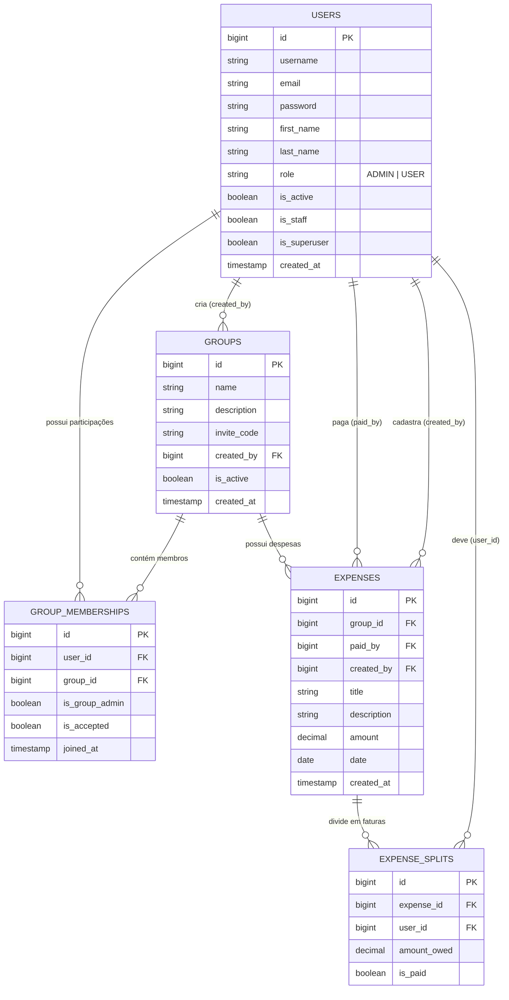

# Gestão de Despesas Django

## Descrição do Projeto

O projeto propõe facilitar o controle de despesas compartilhadas entre grupos, inspirado em ferramentas como o Splitwise. No Checkpoint 1, o foco implementado está na modelagem relacional e na administração dos dados pelo Django Admin. As interfaces de usuário final e os fluxos completos de participação e divisão de despesas permanecem planejados para etapas posteriores.

---

## Integrantes do Projeto

| INTEGRANTE | GITHUB |
| --- | --- |
| Gustavo Alessandro de Souza Sabino | [https://github.com/GUSTAVO-ALESSANDRO](https://github.com/GUSTAVO-ALESSANDRO) |
| Diego Alves de Oliveira | [https://github.com/diego-codev](https://github.com/diego-codev) |
| Caio Bueno Finocchio Martins | [https://github.com/caiobfm](https://github.com/caiobfm) |

---

## Tecnologias Utilizadas

O projeto foi construído utilizando a linguagem Python em conjunto com o framework Django, que fornece a arquitetura MVT, o sistema robusto de autenticação, o mapeamento objeto-relacional e a modularidade necessária para separar a aplicação em componentes reutilizáveis, garantindo organização e escalabilidade ao código-fonte.

Para o armazenamento persistente dos dados, o sistema emprega o banco de dados relacional PostgreSQL, assegurando a integridade referencial por meio de chaves estrangeiras, restrições e transações seguras, enquanto a interface do usuário foi estilizada com o framework CSS Bootstrap, oferecendo uma experiência responsiva, moderna e compatível com temas claros e escuros.

O controle de versão e a colaboração da equipe foram gerenciados através do Git e do GitHub, utilizando branches específicas para organização do fluxo de trabalho, e o painel administrativo do Django foi customizado com temas avançados para atender aos requisitos visuais e de filtragem propostos.

---

## Instruções para Instalação

As instruções abaixo são destinadas ao **Ubuntu/Linux**. O projeto utiliza Python 3, Django, Git e PostgreSQL.

### 1. Instalar as dependências do sistema

```bash
sudo apt update
sudo apt install -y git python3-venv python3-pip postgresql postgresql-contrib
```

### 2. Configurar o PostgreSQL

Inicie o serviço:

```bash
sudo service postgresql start
```

Crie um usuário para a aplicação e defina uma senha quando solicitado:

```bash
sudo -u postgres createuser --pwprompt gestao_despesas
```

Crie o banco de dados associado a esse usuário:

```bash
sudo -u postgres createdb -O gestao_despesas gestao_despesas_db
```

A criação do usuário e do banco precisa ser realizada apenas uma vez.

### 3. Clonar o repositório

```bash
git clone https://github.com/GUSTAVO-ALESSANDRO/gestao-despesas-django.git
cd gestao-despesas-django
```

### 4. Configurar o ambiente Python

```bash
python3 -m venv venv
source venv/bin/activate
python -m pip install -r requirements.txt
```

### 5. Configurar as variáveis de ambiente

Crie o arquivo `.env` a partir do exemplo existente no repositório:

```bash
cp .env.example .env
```

Edite o `.env` com as informações do PostgreSQL:

```ini
DEBUG=True
ALLOWED_HOSTS=localhost,127.0.0.1
DB_NAME=gestao_despesas_db
DB_USER=gestao_despesas
DB_PASSWORD=sua_senha
DB_HOST=localhost
DB_PORT=5432
```

Substitua `sua_senha` pela senha definida na etapa 2. Gere a chave secreta do Django:

```bash
python -c "from django.core.management.utils import get_random_secret_key; print(get_random_secret_key())"
```

Adicione ao `.env` a linha `SECRET_KEY=chave_gerada`, substituindo `chave_gerada` pelo resultado do comando.

**Importante:** o `.env` contém credenciais sensíveis e não deve ser enviado ao GitHub.

### 6. Criar as tabelas e o administrador

Aplique as migrações:

```bash
python manage.py migrate
```

Crie um superusuário para acessar o painel administrativo:

```bash
python manage.py createsuperuser
```

> Se pretende usar o script de dados de demonstração abaixo, execute-o **em vez de** criar o superusuário, pois ele apaga os usuários existentes e cria uma conta administrativa de exemplo.

---

## Instruções para Execução

Com o ambiente virtual ativado e o PostgreSQL em execução, inicie a aplicação:

```bash
python manage.py runserver
```

Acesse no navegador:

- Aplicação: http://127.0.0.1:8000/
- Painel administrativo: http://127.0.0.1:8000/admin/

### Dados de demonstração (opcional)

O arquivo `clear_and_populate.sql` insere usuários, grupos, despesas e divisões de exemplo. **Ele apaga os dados existentes e reinicia as sequências antes da inserção. Utilize-o somente em um banco descartável de desenvolvimento.**

Depois de executar `migrate`, rode:

```bash
psql -h localhost -p 5432 -U gestao_despesas -d gestao_despesas_db -W -v ON_ERROR_STOP=1 --single-transaction -f clear_and_populate.sql
```

O script cria uma conta de demonstração para o Django Admin (`admin` / `admin`). Essas credenciais são apenas para uso local e não devem ser utilizadas em produção.

---

## Principais Funcionalidades

### Implementado no Checkpoint 1

* Dois apps Django (`accounts` e `expenses`), modelos relacionais e migrations para usuários, grupos, memberships, despesas e divisões.
* Django Admin personalizado com Jazzmin. O acesso depende de `is_staff`, permissões Django e `is_superuser`; `role=ADMIN` não promove um usuário a superusuário.
* Formulários de administração de usuários com senha armazenada por hash e redefinição pelo fluxo nativo do admin.
* Inlines de memberships na página do grupo e divisões na página da despesa.
* Filtros de usuários por perfil, status, participação em grupos e data; grupos por status, existência de despesas, quantidade de membros, criador e data; memberships por administrador, aceite e data; despesas por faixa de valor, situação das divisões, grupo, pagador e datas; divisões por quitação, faixa de valor, grupo e usuário. As listagens de memberships e divisões também têm seletores para restringir por grupo ou despesa.
* Gráficos de cadastros de usuários, grupos e despesas por semana, mês e ano. Usam o queryset filtrado da respectiva listagem e contam cadastros; não representam histórico de mudanças de status.
* Validações para o criador aceito e administrador do grupo, memberships sem duplicidade, pagador/cadastrador e participantes aceitos, e valores monetários positivos.

### Planejado para o Checkpoint 2

Cadastro, login e logout de usuários finais; páginas para gerenciar grupos e despesas; fluxos completos de convite e aprovação; divisão automática e atualização de quitação fora do admin.

---

## Modelagem do Banco de Dados



---

`GroupMembership` tem unicidade para o par usuário/grupo; `ExpenseSplit`, para despesa/usuário. O criador é associado como membro aceito e administrador. Pagador e cadastrador da despesa, assim como participantes das divisões, devem ser membros aceitos do grupo. Valores de despesa e divisão precisam ser maiores que zero. A soma das divisões não é validada nesta etapa, pois elas são editadas individualmente.

## Rotas disponíveis

| MÉTODO | ROTA | Explicação | Permissão |
| --- | --- | --- | --- |
| **GET** | `/` | Página inicial atual. | Pública |
| **GET** | `/admin/` | Django Admin com Jazzmin; acesso e operações dependem das permissões Django do usuário. | Usuário autenticado com acesso ao admin |

As rotas de cadastro e autenticação de usuários finais, e as operações de grupos e despesas fora do admin, ainda não estão implementadas. Os dados do Checkpoint 1 são gerenciados pelo `/admin/`.

---

## Estrutura do Projeto

A arquitetura do projeto segue a modularidade recomendada pelo Django, separando as responsabilidades principais entre o núcleo de configuração e os aplicativos específicos da regra de negócio:

```text
gestao-despesas-django/
├── manage.py
├── README.md
├── requirements.txt
├── .env.example
├── .env (criado localmente; não versionado)
├── gestao_despesas/
│   ├── __init__.py
│   ├── asgi.py
│   ├── settings.py
│   ├── urls.py
│   └── wsgi.py
├── accounts/
│   ├── migrations/
│   ├── templates/
│   │   ├── admin/users.html
│   │   ├── base.html
│   │   └── index.html
│   ├── __init__.py
│   ├── admin.py
│   ├── apps.py
│   ├── models.py
│   ├── views.py
│   ├── urls.py
│   └── tests.py
├── expenses/
│   ├── migrations/
│   ├── templates/admin/
│   │   ├── expense.html
│   │   ├── expensesplit.html
│   │   ├── groups.html
│   │   └── groupmembership.html
│   ├── __init__.py
│   ├── admin.py
│   ├── apps.py
│   ├── models.py
│   ├── views.py
│   └── tests.py
├── static/
│   └── js/ (charts.js, theme.js)
└── staticfiles/ (saída gerada para arquivos estáticos)
```

* **gestao_despesas/**: Pasta principal que contém os arquivos de configuração global do projeto.
* **settings.py**: Arquivo onde são definidas as configurações gerais, conexões com o PostgreSQL, aplicativos instalados e middlewares.
* **urls.py**: Arquivo central que mapeia as rotas globais da aplicação web para os aplicativos correspondentes.
* **accounts/**: Modelo customizado de usuário e administração de usuários.
* **expenses/**: Modelos de grupos, memberships, despesas e divisões, com validações e configuração administrativa.
* **static/**: Scripts usados pelo tema e pelos gráficos do admin.
* **manage.py**: Utilitário de linha de comando principal do Django que permite interagir com o projeto para executar tarefas administrativas, como rodar o servidor de desenvolvimento, aplicar migrações e criar superusuários.
* **.env.example**: Modelo versionado das variáveis de ambiente.
* **.env**: Arquivo de configuração local (não versionado) com chave, modo de execução, hosts e credenciais do PostgreSQL.
* **README.md**: Documentação principal do projeto que apresenta a visão geral do sistema, instruções de instalação, arquitetura de pastas e guias de execução.
