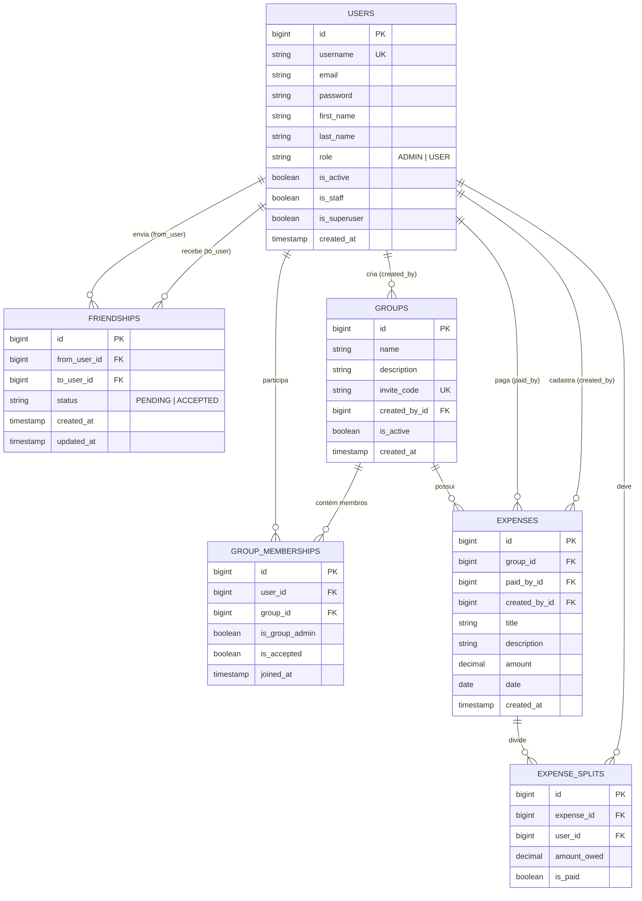

## Descrição do Projeto

O SplitExpenses é uma aplicação web para organizar despesas compartilhadas. Usuários podem criar grupos, convidar participantes, dividir despesas, acompanhar pagamentos, adicionar amigos pelo username e consultar seu histórico pessoal. O projeto foi desenvolvido com Django e arquitetura MVT, autenticação de usuários e persistência em banco de dados relacional.

---

## Integrantes do Projeto

| INTEGRANTE | GITHUB |
| --- | --- |
| Gustavo Alessandro de Souza Sabino | [GUSTAVO-ALESSANDRO](https://github.com/GUSTAVO-ALESSANDRO) |
| Diego Alves de Oliveira | [diego-codev](https://github.com/diego-codev) |
| Caio Bueno Finocchio Martins | [caiobfm](https://github.com/caiobfm) |

---

## Tecnologias Utilizadas

- **Python 3 e Django 6.1.1:** aplicação web, arquitetura MVT, autenticação, formulários e ORM.
- **PostgreSQL:** banco de dados relacional.
- **Jazzmin:** personalização do Django Admin.
- **Bootstrap 5, CSS e JavaScript:** interface responsiva, componentes e temas claro/escuro.
- **WhiteNoise:** publicação de arquivos estáticos.
- **Git e GitHub:** controle de versão e colaboração.

O projeto possui dois aplicativos Django: `accounts`, para usuários e amizades, e `expenses`, para grupos e despesas.

---

## Instruções para Instalação

Tenha Python, PostgreSQL e Git instalados. Os comandos abaixo são executados na raiz do repositório.

### 1. Clonar o repositório

```bash
git clone https://github.com/GUSTAVO-ALESSANDRO/gestao-despesas-django.git
cd gestao-despesas-django
```

### 2. Criar e ativar o ambiente virtual

```bash
python -m venv venv
```

Ative o ambiente:

```powershell
# Windows PowerShell
.\venv\Scripts\Activate.ps1
```

```bash
# Linux/macOS
source venv/bin/activate
```

Instale as dependências:

```bash
python -m pip install -r requirements.txt
```

### 3. Criar o banco PostgreSQL

Crie um banco e usuário PostgreSQL. Exemplo no Linux:

```bash
sudo -u postgres createuser --pwprompt gestao_despesas
sudo -u postgres createdb -O gestao_despesas gestao_despesas_db
```

No Windows, a criação pode ser feita pelo pgAdmin ou por `psql`.

### 4. Configurar as variáveis de ambiente

Copie `.env.example` para `.env`:

```powershell
# Windows PowerShell
Copy-Item .env.example .env
```

```bash
# Linux/macOS
cp .env.example .env
```

Edite `.env` e configure o acesso ao banco:

```ini
SECRET_KEY=chave-secreta-gerada
DEBUG=True
ALLOWED_HOSTS=localhost,127.0.0.1
DB_NAME=gestao_despesas_db
DB_USER=gestao_despesas
DB_PASSWORD=sua_senha
DB_HOST=localhost
DB_PORT=5432
```

Gere uma chave secreta para desenvolvimento, se necessário:

```bash
python -c "from django.core.management.utils import get_random_secret_key; print(get_random_secret_key())"
```

Não publique o arquivo `.env`. Em produção, use `DEBUG=False`, uma chave secreta própria e configure `ALLOWED_HOSTS` e as opções de segurança do ambiente.

### 5. Aplicar migrations e criar o administrador

```bash
python manage.py migrate
python manage.py createsuperuser
```

---

## Instruções para Execução

Com o PostgreSQL ativo e o ambiente virtual habilitado:

```bash
python manage.py runserver
```

Acesse:

- Aplicação: <http://127.0.0.1:8000/>
- Django Admin: <http://127.0.0.1:8000/admin/>

Para validar o projeto e executar a suíte de testes:

```bash
python manage.py check
python manage.py test
```

Os testes utilizam o PostgreSQL configurado e precisam de permissão para criar o banco de testes.

### Dados de demonstração (opcional)

O arquivo `clear_and_populate.sql` limpa as tabelas e insere dados de exemplo. Use somente em um banco descartável; o script apaga dados existentes. Execute depois de `migrate`:

```bash
psql -h localhost -p 5432 -U gestao_despesas -d gestao_despesas_db -W -v ON_ERROR_STOP=1 --single-transaction -f clear_and_populate.sql
```

O usuário de demonstração `admin` tem senha `admin`; os demais usuários de exemplo têm senha `user`. Altere essas senhas antes de qualquer uso fora de desenvolvimento.

---

## Principais Funcionalidades

### Acesso e contas

- Cadastro, login e logout com autenticação por usuário e senha.
- Edição de nome, sobrenome e e-mail do perfil.
- Papéis de usuário comum e administrador. O acesso ao Admin também depende das permissões Django (`is_staff`, permissões e `is_superuser`); `role=ADMIN` não concede superusuário.
- Tema claro/escuro e navegação responsiva.

### Grupos

- Criar grupos; o criador é associado como membro aceito e administrador.
- Código de convite gerado automaticamente para solicitar participação.
- Aprovação de solicitações, promoção/rebaixamento de administradores e remoção de membros.
- Administradores podem adicionar diretamente ao grupo um amigo com amizade aceita.
- Regras para impedir saída/remoção com pendências financeiras e exclusão acidental do grupo.

### Amigos

- Enviar solicitações pelo username.
- Aceitar, recusar ou cancelar solicitações.
- Consultar e remover amizades.
- Solicitações recíprocas aceitam a solicitação pendente existente.

### Despesas e histórico

- Criar, consultar, editar e excluir despesas de grupos, respeitando as permissões.
- Dividir o valor por quantias ou porcentagens; o total das divisões deve corresponder ao valor da despesa.
- Consultar participantes, balanços individuais e valores a pagar/receber.
- Marcar divisões como pagas ou pendentes.
- Histórico pessoal das despesas pagas diretamente pelo usuário, cotas quitadas e cotas ainda devidas, com filtro por situação.
- O sistema registra pagamentos, mas não processa transferências financeiras.

### Administração

- Django Admin personalizado com Jazzmin em `/admin/`.
- Administração de usuários, amizades, grupos, participações, despesas e divisões.
- Filtros, buscas, formulários especializados e gráficos de cadastros nas listagens administrativas.

---

## Modelagem do Banco de Dados



`GroupMembership` é único por grupo/usuário e `ExpenseSplit` é único por despesa/usuário. Amizades impedem relações consigo mesmo e têm status pendente ou aceito. Valores de despesas e divisões devem ser positivos. O pagador, o responsável pelo cadastro e os participantes das divisões precisam ser membros aceitos do grupo.

---

## Rotas Disponíveis

As páginas de usuários finais exigem autenticação, exceto cadastro e login. Para operações de recursos, o projeto usa **GET para consultar**, **POST para criar**, **PUT para editar** e **DELETE para excluir**. Formulários HTML nativos só enviam GET/POST; a interface usa JavaScript `fetch` para enviar PUT/DELETE com o token CSRF.

| MÉTODO | ROTA | Explicação | Permissão |
| --- | --- | --- | --- |
| **GET** | `/` | Página inicial e resumo financeiro. | Usuário autenticado |
| **GET, POST** | `/cadastro/` | Exibir e criar uma conta de usuário comum. | Público |
| **GET, POST** | `/login/` | Exibir formulário e autenticar usuário. | Público |
| **POST** | `/logout/` | Encerrar a sessão. | Usuário autenticado |
| **GET, PUT** | `/perfil/` | Consultar e editar o perfil. | Usuário autenticado |
| **GET, POST** | `/amigos/` | Listar amigos/solicitações e enviar pedido de amizade. | Usuário autenticado |
| **PUT** | `/amigos/solicitacao/<friendship_id>/acao/` | Aceitar uma solicitação recebida (`action=accept`). | Destinatário |
| **DELETE** | `/amigos/solicitacao/<friendship_id>/acao/` | Recusar ou cancelar solicitação (`action=decline`/`cancel`). | Destinatário/remetente |
| **DELETE** | `/amigos/<user_id>/remover/` | Remover uma amizade aceita. | Usuário autenticado |
| **GET** | `/groups/` | Listar os grupos do usuário. | Usuário autenticado |
| **GET, POST** | `/groups/new/` | Exibir formulário e criar grupo. | Usuário autenticado |
| **GET, PUT** | `/groups/<pk>/` | Consultar grupo ou editar suas informações (`action=update_info`). | Membro; edição por administrador |
| **POST** | `/groups/join/` | Solicitar entrada usando código de convite. | Usuário autenticado |
| **DELETE** | `/groups/<pk>/leave/` | Sair do grupo ou excluir o grupo quando for o único membro. | Membro |
| **PUT, DELETE** | `/groups/<group_id>/members/<membership_id>/action/` | Aceitar/promover/rebaixar (`PUT`) ou remover membro (`DELETE`). | Administrador do grupo |
| **POST** | `/groups/<pk>/add-friend/` | Adicionar amigo aceito ao grupo. | Administrador do grupo |
| **GET, POST** | `/groups/<group_id>/expenses/new/` | Exibir formulário e criar despesa/divisões. | Membro aceito |
| **GET** | `/groups/expenses/` | Listar despesas dos grupos do usuário. | Usuário autenticado |
| **GET** | `/groups/expenses/<pk>/` | Consultar despesa e suas divisões. | Membro do grupo |
| **GET, PUT** | `/groups/expenses/<pk>/edit/` | Exibir formulário e editar despesa/divisões. | Criador, pagador ou administrador |
| **GET, DELETE** | `/groups/expenses/<pk>/delete/` | Exibir confirmação e excluir despesa. | Criador, pagador ou administrador |
| **PUT** | `/groups/splits/<split_id>/toggle-paid/` | Atualizar o status de pagamento de uma divisão. | Usuário autorizado |
| **GET** | `/groups/history/` | Consultar histórico; aceita `?status=pending` ou `?status=paid`. | Usuário autenticado |
| **GET** | `/admin/` | Painel administrativo Jazzmin. | Usuário autenticado com permissões Django |

---

## Estrutura do Projeto

```text
gestao-despesas-django/
├── manage.py
├── README.md
├── requirements.txt
├── .env.example
├── .env                         # criado localmente; não versionado
├── clear_and_populate.sql       # dados de demonstração; limpa o banco
├── gestao_despesas/
│   ├── settings.py
│   ├── urls.py
│   ├── asgi.py
│   └── wsgi.py
├── accounts/
│   ├── migrations/
│   ├── templates/
│   │   ├── accounts/
│   │   ├── admin/
│   │   ├── app_base.html
│   │   ├── base.html
│   │   └── index.html
│   ├── admin.py
│   ├── forms.py
│   ├── models.py
│   ├── services.py
│   ├── urls.py
│   ├── views.py
│   └── tests.py
├── expenses/
│   ├── migrations/
│   ├── templates/
│   │   ├── admin/
│   │   └── expenses/
│   ├── admin.py
│   ├── forms.py
│   ├── models.py
│   ├── services.py
│   ├── urls.py
│   ├── views.py
│   └── tests.py
├── static/
│   ├── css/
│   └── js/
└── staticfiles/                  # arquivos estáticos coletados
```

- **`gestao_despesas/`**: configurações globais, banco, autenticação e rotas principais.
- **`accounts/`**: usuário customizado, autenticação, perfil, amizades e administração de contas.
- **`expenses/`**: grupos, membros, despesas, divisões, validações e cálculo de balanços.
- **`static/`**: estilos e scripts da interface. Em produção, execute `python manage.py collectstatic`.
- **`staticfiles/`**: diretório de saída dos arquivos estáticos coletados.

## Controle de Versão e Colaboração

O fluxo de trabalho previsto utiliza Git e GitHub, com as branches `main` (versão estável), `develop` (integração) e `feature/<assunto>` (funcionalidades). As alterações devem ser integradas por pull requests.
