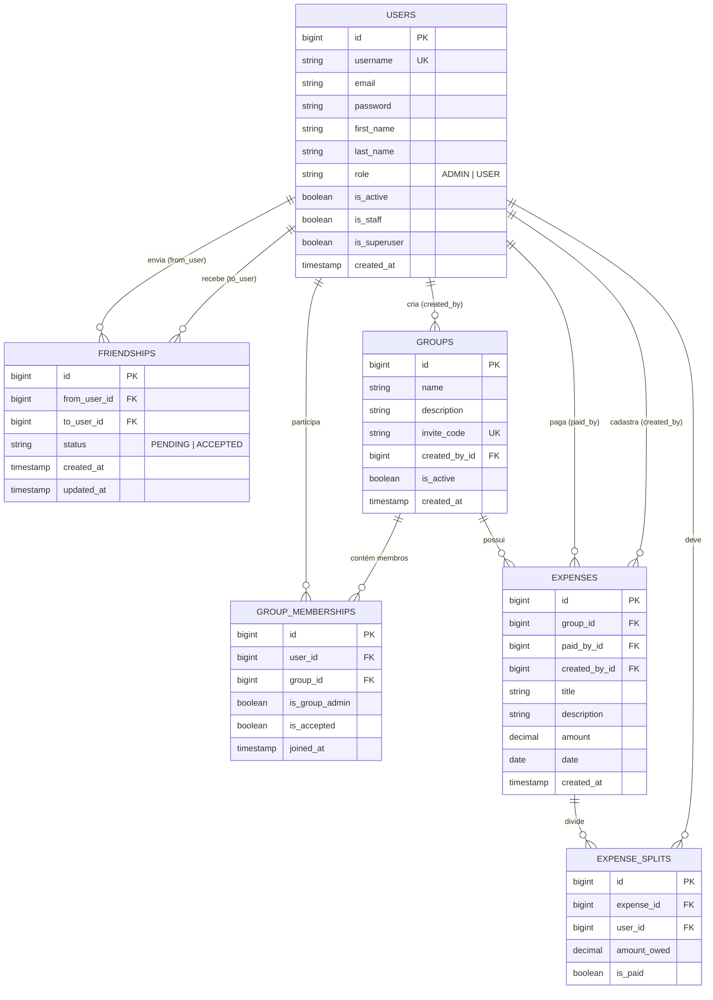

# Gestão de Despesas Django

## Descrição do Projeto

O SplitExpenses é uma aplicação web para organizar despesas compartilhadas entre pessoas, onde usuários criam grupos, convidam participantes por código, registram despesas pagas por membros do grupo e distribuem o valor em cotas em reais. A aplicação acompanha os valores pagos e pendentes, calcula saldos entre participantes, permite administrar amizades e grupos e oferece histórico pessoal e relatórios administrativos, e o sistema registra o estado das divisões, mas não movimenta dinheiro nem processa transferências.

---

## Integrantes do Projeto

| INTEGRANTE | GITHUB |
| --- | --- |
| Gustavo Alessandro de Souza Sabino | [GUSTAVO-ALESSANDRO](https://github.com/GUSTAVO-ALESSANDRO) |
| Diego Alves de Oliveira | [diego-codev](https://github.com/diego-codev) |
| Caio Bueno Finocchio Martins | [caiobfm](https://github.com/caiobfm) |

---

## Tecnologias Utilizadas

O backend é desenvolvido em Python 3 com Django 6.1.1, usando a arquitetura MVT, autenticação, formulários e ORM. O PostgreSQL armazena os dados relacionais. Jazzmin personaliza o Django Admin, enquanto Bootstrap 5, CSS e JavaScript formam a interface responsiva, com temas claro e escuro, modais e interações de formulário. WhiteNoise serve os arquivos estáticos em produção.

O projeto está dividido em dois aplicativos Django. `accounts` implementa usuários, autenticação, perfil, amizades e relatórios; `expenses` implementa grupos, participações, despesas, divisões, pagamentos, balanços e histórico. O pacote `gestao_despesas` reúne as configurações e rotas principais do projeto.

---

## Instruções para Instalação

Tenha Python, PostgreSQL e Git instalados. Os comandos abaixo são executados na raiz do repositório.

### Clonar o repositório

```bash
git clone https://github.com/GUSTAVO-ALESSANDRO/gestao-despesas-django.git
cd gestao-despesas-django
```

### Criar e ativar o ambiente virtual

```bash
python -m venv venv
```

Ative o ambiente virtual com o comando correspondente ao sistema operacional:

```powershell
# Windows PowerShell
.\venv\Scripts\Activate.ps1
```

```bash
# Linux/macOS
source venv/bin/activate
```

Com o ambiente ativo, instale as dependências:

```bash
python -m pip install -r requirements.txt
```

### Criar o banco PostgreSQL

Crie um banco e usuário PostgreSQL. Exemplo no Linux:

```bash
sudo -u postgres createuser --pwprompt gestao_despesas
sudo -u postgres createdb -O gestao_despesas gestao_despesas_db
```

No Windows, crie o banco e o usuário pelo pgAdmin ou pelo cliente `psql`.

### Configurar as variáveis de ambiente

Copie `.env.example` para `.env` e edite o arquivo com os dados do banco e as configurações locais:

```powershell
# Windows PowerShell
Copy-Item .env.example .env
```

```bash
# Linux/macOS
cp .env.example .env
```

Edite `.env` e configure o acesso ao banco:

```ini
SECRET_KEY=chave-secreta-gerada
DEBUG=True
ALLOWED_HOSTS=localhost,127.0.0.1
DB_NAME=gestao_despesas_db
DB_USER=gestao_despesas
DB_PASSWORD=sua_senha
DB_HOST=localhost
DB_PORT=5432
```

Gere uma chave secreta para desenvolvimento, se necessário:

```bash
python -c "from django.core.management.utils import get_random_secret_key; print(get_random_secret_key())"
```

Em produção, use `DEBUG=False`, uma chave secreta própria e configure `ALLOWED_HOSTS` e as opções de segurança do ambiente.

### Aplicar migrations e criar o administrador

```bash
python manage.py migrate
python manage.py createsuperuser
```

---

## Instruções para Execução

Com o PostgreSQL ativo e o ambiente virtual habilitado:

```bash
python manage.py runserver
```

A aplicação fica disponível em <http://127.0.0.1:8000/> e o painel Django Admin em <http://127.0.0.1:8000/admin/>.

Para validar o projeto e executar a suíte de testes:

```bash
python manage.py check
python manage.py test
```

Os testes utilizam o PostgreSQL configurado e precisam de permissão para criar o banco de testes.

### Dados de demonstração (opcional)

O arquivo `clear_and_populate.sql` limpa as tabelas e insere dados de exemplo. Use somente em um banco descartável; o script apaga dados existentes. Execute depois de `migrate`:

```bash
psql -h localhost -p 5432 -U gestao_despesas -d gestao_despesas_db -W -v ON_ERROR_STOP=1 --single-transaction -f clear_and_populate.sql
```

O usuário de demonstração `admin` tem senha `admin`; os demais usuários de exemplo têm senha `user`. Altere essas senhas antes de qualquer uso fora de desenvolvimento.

---

## Funcionalidades

### Acesso e contas

O cadastro público cria contas comuns, e o acesso às páginas internas exige autenticação, na qual o usuário pode entrar e sair da sessão e alterar o nome, o sobrenome e o e-mail do perfil. O campo de papel distingue `USER` de `ADMIN`, mas o acesso ao Django Admin é controlado pelas permissões próprias do Django, como `is_staff`, permissões atribuídas e `is_superuser`; o valor `role=ADMIN`, isoladamente, não concede acesso administrativo.

A interface adapta-se a diferentes tamanhos de tela e oferece tema claro ou escuro. Mensagens de confirmação e avisos são apresentados em modais quando aplicável.

### Grupos

Ao criar um grupo, seu criador passa a ser membro aceito e administrador do grupo e cada grupo recebe um código de convite único, que pode ser informado por outra conta para solicitar entrada e a solicitação fica pendente até que um administrador do grupo a aceite ou recuse. Administradores também podem alterar o título, a descrição e o código de convite, promover membros aceitos, rebaixar administradores e adicionar diretamente amigos cuja amizade já foi aceita.

Um grupo não pode ficar sem administrador enquanto ainda tiver outros participantes, o último administrador precisa promover outro administrador antes de sair ou ser removido. A saída também é bloqueada enquanto o usuário tiver obrigações financeiras pendentes no grupo, seja uma cota que deve pagar ou uma cota ainda devida a ele. A exclusão do grupo pela interface só é oferecida quando resta apenas o próprio usuário no grupo; é necessário confirmar a operação, e a exclusão é impedida se houver obrigações financeiras pendentes no grupo.

Um membro não pode ser removido se for o último administrador ou se houver valores pendentes associados a ele, incluindo valores que deve pagar e valores que outros participantes ainda lhe devem. A remoção de um administrador também não pode deixar o grupo sem outro administrador.

### Amigos

Usuários podem enviar solicitações de amizade pelo username, aceitar ou recusar solicitações recebidas, cancelar solicitações enviadas e remover amizades já aceitas, mas não é permitido adicionar a própria conta. Quando existe uma solicitação pendente no sentido inverso, uma nova solicitação recíproca aceita a relação existente em vez de criar outra.

### Despesas e histórico

Uma despesa pertence a um grupo e registra título, descrição opcional, data, valor total, quem pagou e quem a cadastrou. O pagador e o responsável pelo cadastro precisam ser membros aceitos do grupo e o valor pode ser dividido manualmente entre os participantes aceitos ou repartido igualmente pela interface. Cada cota é informada em reais, precisa ser positiva e ter no máximo duas casas decimais, e a soma das cotas deve corresponder exatamente ao total da despesa.

O criador da despesa, seu pagador, os administradores do grupo e o superusuário podem editar ou excluir a despesa, desde que as regras de acesso ao grupo sejam satisfeitas. As divisões mostram os valores devidos e seu estado de pagamento. Um participante autorizado pode marcar sua própria cota como paga ou pendente; o pagador não altera a própria cota, pois ela representa sua parte do valor que adiantou.

As páginas de grupo e de despesa apresentam o total registrado, cotas pagas e pendentes e balanços entre participantes, o cálculo do saldo não trata a cota do próprio pagador como dívida dele para consigo mesmo e o histórico pessoal reúne despesas pagas diretamente pelo usuário e suas cotas em despesas de outras pessoas, com filtro para exibir todas, pendentes ou pagas. Esses registros representam o controle das obrigações no sistema, não uma confirmação de transferência bancária.

### Relatórios

Os relatórios gerais estão disponíveis somente para superusuários. A página apresenta indicadores de usuários e grupos ativos, quantidade e valor das despesas, valores pendentes e pagos, totais por grupo e uma lista dos usuários com maiores valores pendentes a pagar.

### Administração

O Django Admin personalizado com Jazzmin está disponível em `/admin/` para contas com permissões administrativas Django. O painel permite administrar usuários, amizades, grupos, participações, despesas e divisões, e as listagens incluem buscas e filtros, formulários especializados validam pagadores e participantes de despesas, e gráficos apresentam informações das listagens administrativas.

---

## Modelagem do Banco de Dados



---

## Rotas e métodos HTTP

As rotas abaixo refletem os caminhos registrados pela aplicação. Formulários HTML usam `GET` para consulta, `POST` para criação, `PUT` para atualização e `DELETE` para remoção. Como formulários HTML nativos não enviam `PUT` ou `DELETE`, a interface usa `data-method` e o JavaScript em `static/js/app-ui.js` envia essas requisições por `fetch`, incluindo o token CSRF. As requisições de alteração enviam dados URL-encoded. Para requisições da interface, o servidor devolve o destino da navegação em JSON; para outros clientes, redireciona após a ação.

| METODO | ROTA | O QUE FAZ | PERMISSÃO |
|---|---|---|---|
| GET | `/` | Exibe a página inicial e o resumo financeiro. | Usuário autenticado. |
| GET | `/cadastro/` | Exibe o formulário de cadastro. | Público; usuários autenticados são redirecionados para a página inicial. |
| POST | `/cadastro/` | Cria uma conta de usuário comum. | Público; usuários autenticados são redirecionados para a página inicial. |
| GET | `/login/` | Exibe a página de login. | Público; usuários autenticados são redirecionados conforme a configuração da view. |
| POST | `/login/` | Autentica o usuário. | Público. |
| POST | `/logout/` | Encerra a sessão atual. | Não exige permissão específica; encerra a sessão do cliente. |
| GET | `/perfil/` | Exibe os dados do perfil. | Usuário autenticado. |
| PUT | `/perfil/` | Atualiza nome, sobrenome e e-mail do usuário autenticado. | Usuário autenticado; altera somente o próprio perfil. |
| GET | `/amigos/` | Lista amizades e solicitações recebidas ou enviadas. | Usuário autenticado. |
| POST | `/amigos/` | Envia uma solicitação de amizade pelo username. | Usuário autenticado. |
| PUT | `/amigos/solicitacao/<int:friendship_id>/acao/` | Aceita uma solicitação pendente com `action=accept`. | Somente o destinatário da solicitação. |
| DELETE | `/amigos/solicitacao/<int:friendship_id>/acao/` | Recusa uma solicitação com `action=reject` ou cancela com `action=cancel`. | Destinatário pode recusar; remetente pode cancelar. |
| DELETE | `/amigos/<int:user_id>/remover/` | Remove uma amizade aceita. | Usuário autenticado que participa da amizade. |
| GET | `/relatorios/` | Exibe os relatórios gerais do sistema. | Somente superusuário. |
| GET | `/groups/` | Lista os grupos ativos dos quais o usuário participa com solicitação aceita. | Usuário autenticado. |
| GET | `/groups/new/` | Exibe o formulário de criação de grupo. | Usuário autenticado. |
| POST | `/groups/new/` | Cria um grupo e associa o criador como administrador. | Usuário autenticado. |
| GET | `/groups/<int:pk>/` | Exibe os dados, participantes, despesas e saldos do grupo. | Participante com entrada aceita ou superusuário. |
| PUT | `/groups/<int:pk>/` | Atualiza título, descrição e código de convite com `action=update_info`. | Administrador participante do grupo. |
| POST | `/groups/join/` | Solicita entrada em um grupo usando o código de convite. | Usuário autenticado. |
| DELETE | `/groups/<int:pk>/leave/` | Remove a participação do usuário ou, se for o único participante, exclui o grupo mediante confirmação. | Usuário com participação registrada; o último administrador não pode sair enquanto houver outros participantes, e pendências financeiras impedem a saída ou exclusão. |
| PUT | `/groups/<int:group_id>/members/<int:membership_id>/action/` | Aceita um pedido (`action=accept`), promove (`action=promote`) ou rebaixa (`action=demote`) um participante. | Administrador participante do grupo; não é permitido rebaixar o último administrador. |
| DELETE | `/groups/<int:group_id>/members/<int:membership_id>/action/` | Remove um participante ou recusa um pedido de entrada (`action=kick`). | Administrador participante do grupo; não pode remover o último administrador nem participante com pendências financeiras. |
| POST | `/groups/<int:pk>/add-friend/` | Adiciona diretamente ao grupo um amigo com amizade aceita. | Administrador participante do grupo; a pessoa adicionada precisa ser sua amizade aceita. |
| GET | `/groups/<int:group_id>/expenses/new/` | Exibe o formulário de criação de despesa e suas divisões. | Participante aceito do grupo ou superusuário. |
| POST | `/groups/<int:group_id>/expenses/new/` | Cria uma despesa e suas divisões em reais. | Participante aceito do grupo ou superusuário. |
| GET | `/groups/expenses/` | Lista as despesas dos grupos do usuário. | Usuário autenticado; lista somente despesas de grupos nos quais tem participação aceita. |
| GET | `/groups/expenses/<int:pk>/` | Exibe os dados da despesa, suas cotas e os estados de pagamento. | Participante aceito do grupo da despesa ou superusuário. |
| GET | `/groups/expenses/<int:pk>/edit/` | Exibe o formulário de edição da despesa. | Criador da despesa, pagador, administrador do grupo ou superusuário. |
| PUT | `/groups/expenses/<int:pk>/edit/` | Atualiza a despesa e suas divisões. | Criador da despesa, pagador, administrador do grupo ou superusuário. |
| GET | `/groups/expenses/<int:pk>/delete/` | Exibe a confirmação de exclusão da despesa. | Criador da despesa, pagador, administrador do grupo ou superusuário. |
| DELETE | `/groups/expenses/<int:pk>/delete/` | Exclui a despesa e suas divisões. | Criador da despesa, pagador, administrador do grupo ou superusuário. |
| PUT | `/groups/splits/<int:split_id>/toggle-paid/` | Alterna o estado de uma cota entre paga e a pagar. | Participante responsável pela cota ou pessoa autorizada a gerenciar a despesa; não é possível alternar a cota própria do pagador. |
| GET | `/groups/history/` | Exibe o histórico financeiro pessoal; aceita `?status=pending` ou `?status=paid` para filtrar cotas. | Usuário autenticado. |
| GET, POST (conforme a operação) | `/admin/` e rotas internas geradas pelo Django | Abre o painel administrativo Django/Jazzmin e suas páginas internas de consulta, cadastro e edição. | Usuário staff autenticado com as permissões Django correspondentes. |

---

## Estrutura do Projeto

```text
gestao-despesas-django/
├── manage.py
├── README.md
├── LICENSE
├── .gitignore
├── requirements.txt
├── .env.example
├── .env                         # criado localmente; não versionado
├── clear_and_populate.sql       # dados de demonstração; limpa o banco
├── gestao_despesas/
│   ├── settings.py
│   ├── urls.py
│   ├── asgi.py
│   ├── wsgi.py
│   └── http.py
├── accounts/
│   ├── migrations/
│   │   ├── 0001_initial.py
│   │   ├── 0002_restricoes_e_metadados.py
│   │   └── 0003_friendship.py
│   ├── templates/
│   │   ├── accounts/
│   │   │   ├── auth_base.html
│   │   │   ├── cadastro.html
│   │   │   ├── footer.html
│   │   │   ├── friends.html
│   │   │   ├── login.html
│   │   │   ├── navbar.html
│   │   │   ├── perfil.html
│   │   │   └── relatorios.html
│   │   ├── admin/
│   │   │   └── users.html
│   │   ├── 404.html
│   │   ├── 500.html
│   │   ├── app_base.html
│   │   ├── base.html
│   │   └── index.html
│   ├── admin.py
│   ├── apps.py
│   ├── filters.py
│   ├── forms.py
│   ├── models.py
│   ├── services.py
│   ├── urls.py
│   ├── views.py
│   └── tests.py
├── expenses/
│   ├── migrations/
│   │   ├── 0001_initial.py
│   │   ├── 0002_invite_code_opcional.py
│   │   ├── 0003_restricoes_e_metadados.py
│   │   └── 0004_associate_group_creators.py
│   ├── templates/
│   │   ├── admin/
│   │   │   ├── expense.html
│   │   │   ├── expensesplit.html
│   │   │   ├── groupmembership.html
│   │   │   └── groups.html
│   │   └── expenses/
│   │       ├── expense_confirm_delete.html
│   │       ├── expense_detail.html
│   │       ├── expense_form.html
│   │       ├── expense_list_all.html
│   │       ├── group_detail.html
│   │       ├── group_form.html
│   │       ├── group_list.html
│   │       ├── group_messages.html
│   │       └── personal_history.html
│   ├── admin.py
│   ├── apps.py
│   ├── filters.py
│   ├── forms.py
│   ├── models.py
│   ├── services.py
│   ├── urls.py
│   ├── views.py
│   └── tests.py
├── static/
│   ├── css/
│   │   ├── app-shell.css
│   │   ├── app-ui.css
│   │   ├── auth.css
│   │   ├── dashboard.css
│   │   ├── expenses.css
│   │   ├── groups.css
│   │   └── theme.css
│   └── js/
│       ├── app-ui.js
│       ├── charts.js
│       ├── http-method-forms.js
│       └── theme.js
└── staticfiles/                  # arquivos estáticos coletados
```

`gestao_despesas/` contém as configurações do Django, as rotas raiz e os auxiliares para leitura de formulários e redirecionamento após requisições PUT e DELETE, `accounts/` concentra o modelo de usuário customizado, as amizades, formulários, serviços, views, rotas, testes e templates de autenticação, perfil e relatórios, já `expenses/` reúne os modelos e validações de grupos, participações, despesas e divisões, os cálculos de balanço, as regras de acesso, as rotas, os testes e os templates das telas de grupos, despesas e histórico.

`static/css/` contém os estilos da aplicação, enquanto `static/js/` contém o controle dos modais e do envio de métodos PUT/DELETE, dos temas e dos gráficos administrativos. Em produção, `python manage.py collectstatic` reúne os arquivos estáticos em `staticfiles/`, diretório de saída servido pelo WhiteNoise.
